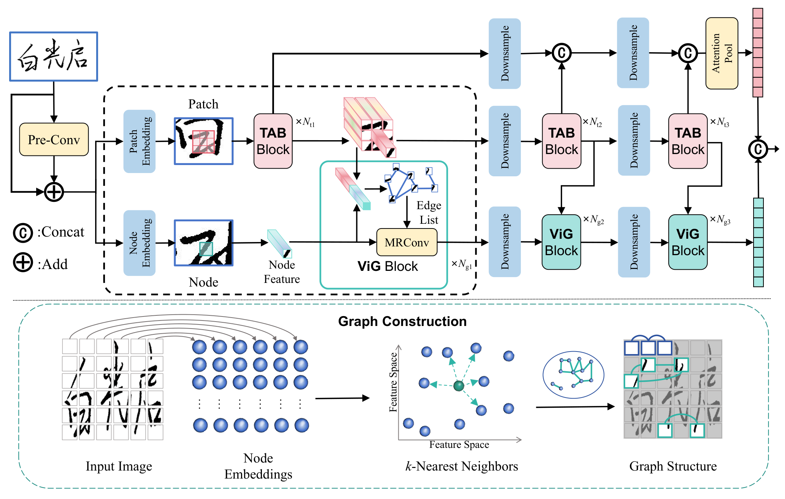
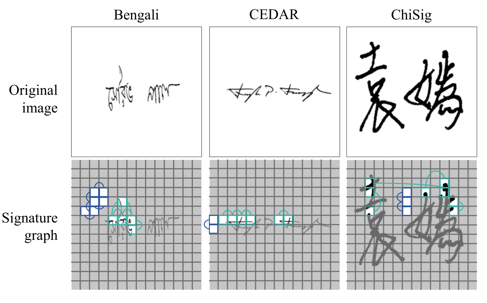
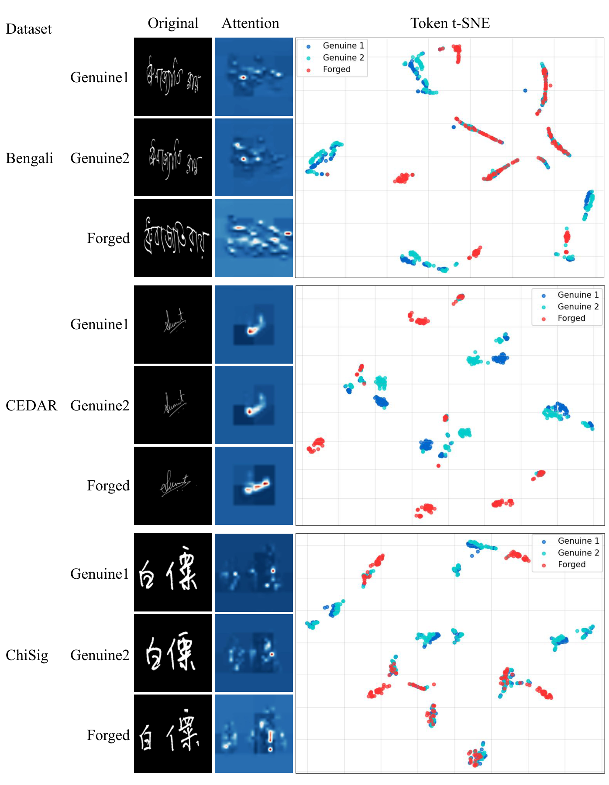
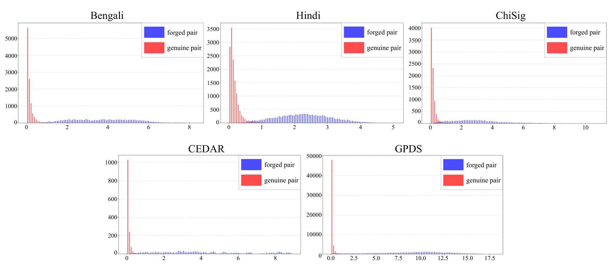

<h1 align="center">TiGSigNet</h1>

<p align="center">
  <strong>Token-interaction Graph Signature Network<br>for Offline Signature Verification</strong>
</p>

<p align="center">
  
</p>

## Visualization

### Signature Graphs

<p align="center">
  
</p>

### Attention Maps and Token Features

<p align="center">
  
</p>

### Distance Distributions

<p align="center">
  
</p>

## Installation

```bash
python -m pip install -r requirements.txt
```

## Training

```bash
python train.py --dataset chisig_all --data-root data --device cuda:0 --batch-size 16 --workers 8 --epochs 25 --output-dir checkpoints --run-name chisig_all
```

## Testing

```bash
python test.py --checkpoint "PATH_TO_CHECKPOINT.pt" --dataset cedar --data-root data --device cuda:0 --workers 8
```
